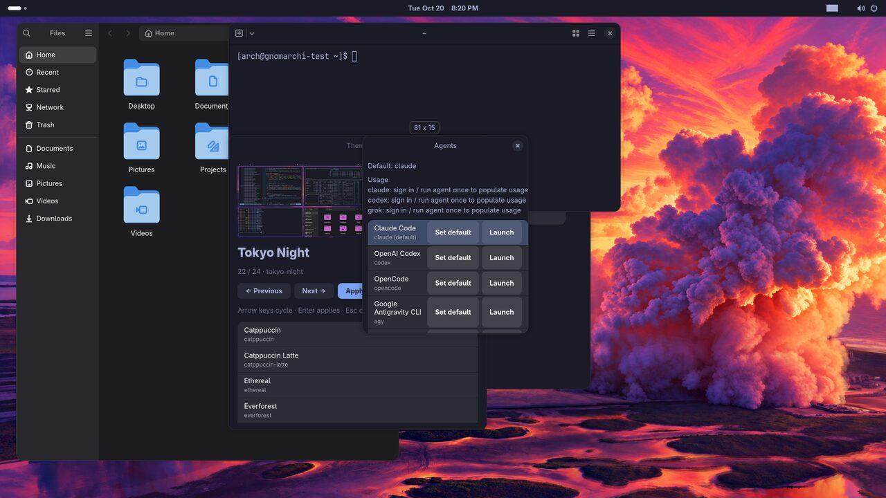
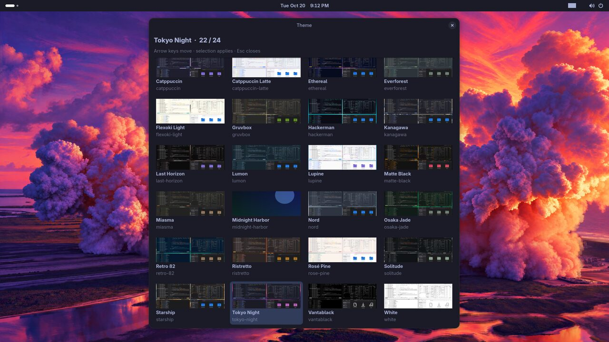
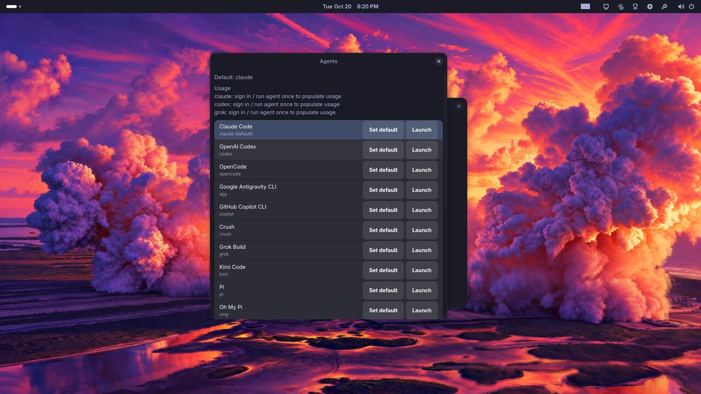
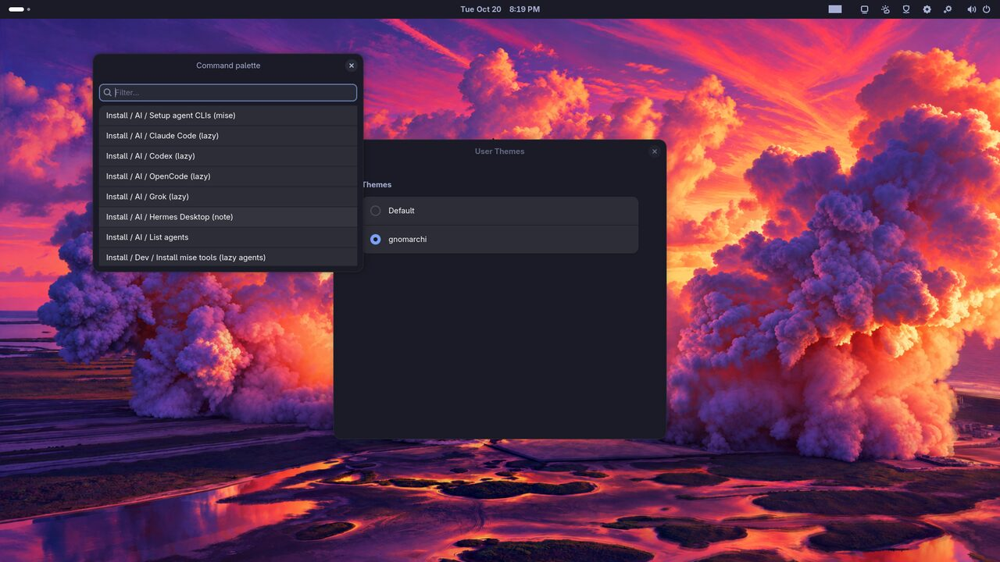
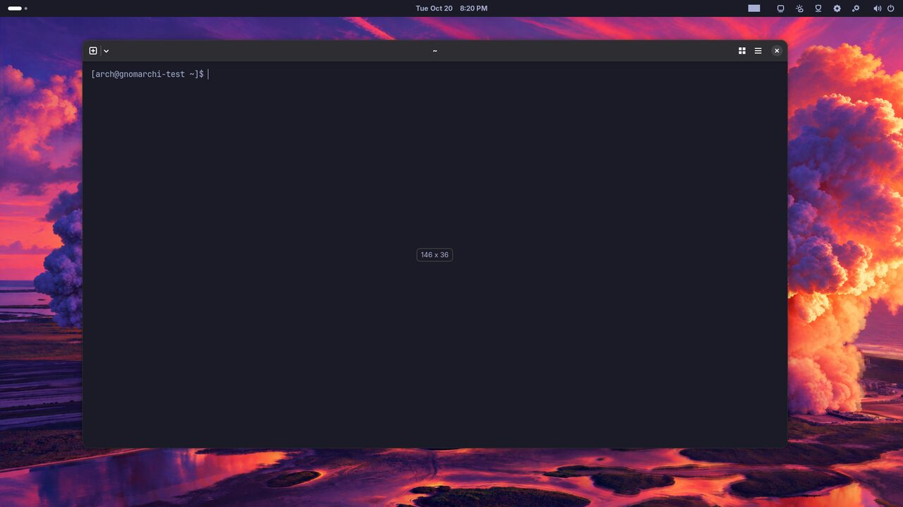
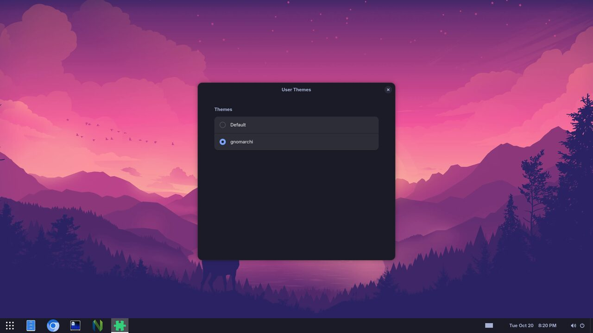

# gnomarchi

<p align="center">
  
</p>

<p align="center"><strong>v0.0.1-beta.1</strong> · stock GNOME omakase for Arch</p>

**Experimental.** gnomarchi ports [Omarchy](https://omarchy.org)’s omakase Arch desktop — themes, menu, plugins, agents, and overlay install — onto **stock GNOME** instead of Hyprland/Quickshell.

**Not affiliated with Omarchy, Basecamp, or DHH.** Inspired by Omarchy’s product shape; we do not claim partnership or endorsement.

## Screenshots

<p align="center">
  
</p>

<p align="center">
  
</p>

<p align="center">
  
  
</p>

<p align="center">
  
  
</p>

More validation shots: [`docs/screenshots/parity-v2/`](docs/screenshots/parity-v2/) · Omarchy originals: [`docs/screenshots/omarchy-manual/`](docs/screenshots/omarchy-manual/) · parity map: [`docs/omarchy-manual-parity.html`](docs/omarchy-manual-parity.html)

## Quick start

On Arch with GNOME already installed:

```bash
git clone https://github.com/lookatitude/gnomarchi.git
cd gnomarchi
./install/overlay.sh
```

CLI: `gnomarchi` (`theme`, `menu`, `agent`, `notice`, `webapp`, `share`, `install`, …).

```bash
gnomarchi theme pick          # all theme packs
gnomarchi theme set tokyo-night
Super+Space                   # unified menu
```

## Install channels

| Channel | How |
| --- | --- |
| **Overlay** (dev / existing Arch+GNOME) | `./install/overlay.sh` |
| **Release tarball** | GitHub Releases → `gnomarchi-0.0.1-beta.1.tar.gz` |
| **AUR-style PKGBUILD** | `packaging/aur/gnomarchi/` (`makepkg -si`) |
| **Custom pacman repo** | `packaging/repo/` — build pkgs, `./packaging/repo/build-repo.sh`, host mirror |
| **ISO** (WIP) | `iso/build.sh` (needs `archiso`) |

```bash
# From a release tag
./scripts/build-release.sh          # source archive + checksums under dist/
# Optional Arch package
cd packaging/aur/gnomarchi && makepkg -si
```

## Status (v0.0.1-beta.1)

Feature gap map vs Omarchy manual: **43/43 done** on the GNOME adaptation path (Hyprland/Quickshell replaced by GNOME Shell + GDM by design). Tracker: `features/registry.yaml` · `docs/parity/gnomarchi-gap-map.json`.

```bash
python3 -m unittest discover -s tests
```

## License

MIT — see [LICENSE](LICENSE). Theme pack assets keep their own credits under `theme/packs/*/CREDITS` where present.
